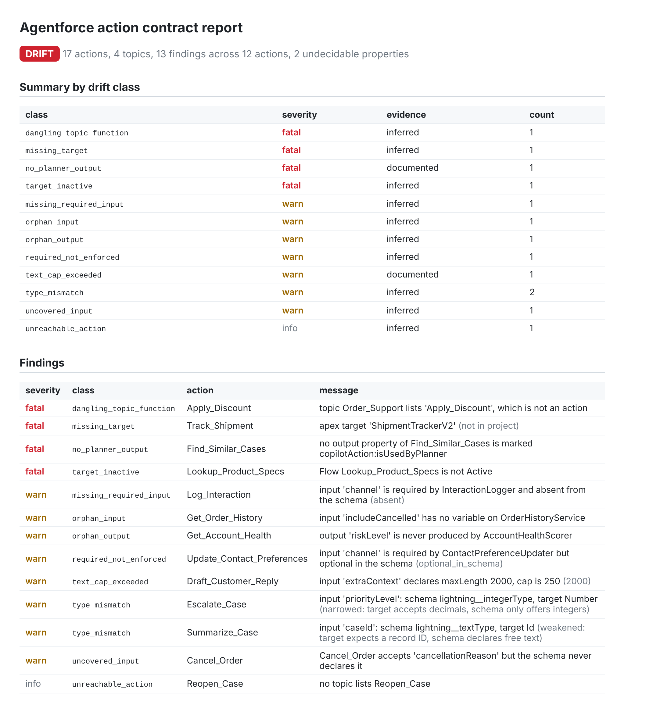

# agentforce-action-contract-linter

**Reads an SFDX project and reconciles every Agentforce action's `input/schema.json` and `output/schema.json` against the invocable Apex or Flow named by its `invocationTarget`, by name and by type, and reports what it could not check alongside what it found.**

[](https://github.com/ManojKumarChunduru/agentforce-action-contract-linter/actions/workflows/ci.yml)


## The thing the metadata cannot tell you

An Agentforce action is three files that nothing joins. `Action.genAiFunction-meta.xml` names
its target as a string (`<invocationTarget>CaseSummarizer</invocationTarget>`). `input/schema.json`
and `output/schema.json` describe the inputs and outputs the planner will use. The Apex class or
Flow behind the target declares what it actually accepts and returns. There is no edge in the
metadata between a schema property and the `@InvocableVariable` or Flow variable it is meant to
describe, only a name that nobody is required to check. So four questions have no answer in the
metadata, however carefully it is read:

1. Does the Apex `Id caseId` the target insists on still match the `lightning__textType` the
   schema declares, or did one side change?
2. Does a variable the Apex marks `required=true` appear in the schema's `required` list, or can
   the planner call the action without it?
3. Is any output property marked `copilotAction:isUsedByPlanner`, without which the reference
   says the planner returns random responses?
4. Can the planner reach the action at all: does a topic list it, and does every action the
   topics list exist?

This repository draws that edge. It also says, per property, when it could not.

## The numbers, uncomfortable ones first

On a fixture org of 17 actions (12 backed by Apex, 5 backed by Flow) across 4 topics, with one
instance of every drift class planted on purpose:

- **2 of 17 actions are undecidable** (11.8% of actions): the linter refused to judge a
  property on each because the target's type is an SObject and no `lightning:type` can carry a
  record. These are reported apart from drift and apart from clean. A clean verdict that hides an
  unchecked action would be worse than no verdict.
- **3 of 4 fatal drift classes rest on inference, not documentation.** Of the 12 drift classes,
  2 of 12 classes have a consequence the GenAiFunction reference states; 10 are inferred from the
  contract and have not been observed against an org, so only 1 of the fatal classes is
  documented. The policy is defensible; the evidence for it is thinner than the exit code
  suggests, and [ADR-003](docs/adr/ADR-003-severity-apart-from-evidence.md) says so.
- **A name-only review sees 7 of 13 findings.** The 6 it misses (46.2% of the findings)
  have the right property names on both sides: 2 type mismatches, a required variable
  that is present but unenforced, a text cap, a missing planner flag and an inactive Flow.

The credibility line: 250 tests at 99.5% line coverage, 13 findings across 12 of 17 actions
(11 with contract drift, the rest reachability) matching 13 of 13 planted drifts with a resolution floor of 1/13 on this fixture, and every
figure in this document re-measured by CI and held to the prose by `tools/check_numbers.py`.

## Quickstart

Prerequisites: Python 3.11 or later. Nothing else at runtime. No org, no credentials, no network.

```bash
git clone https://github.com/ManojKumarChunduru/agentforce-action-contract-linter.git
cd agentforce-action-contract-linter
python -m pip install -e ".[dev]"

# the headline: reconcile the fixture org (exit code 1, because drift is planted)
afcl lint fixture

# the same, as JSON for a pipeline, or markdown for a job summary
afcl lint fixture --format json
afcl lint fixture --format markdown --output report.md

# everything re-measured and every number in this README re-checked
make verify
```

Point it at your own project: `afcl lint path/to/sfdx-project`. It reads `sfdx-project.json`,
walks every package directory, and needs nothing that is not already in source control.

## What it reports, and what it refuses to

`afcl classes` prints the 12 drift classes with their severity and evidence. The table it
produces on the fixture:

| class | severity | evidence | fixture |
| --- | --- | --- | --- |
| `missing_target` | fatal | inferred | 1 |
| `target_inactive` | fatal | inferred | 1 |
| `no_planner_output` | fatal | documented | 1 |
| `dangling_topic_function` | fatal | inferred | 1 |
| `orphan_input` | warn | inferred | 1 |
| `uncovered_input` | warn | inferred | 1 |
| `missing_required_input` | warn | inferred | 1 |
| `required_not_enforced` | warn | inferred | 1 |
| `type_mismatch` | warn | inferred | 2 |
| `orphan_output` | warn | inferred | 1 |
| `text_cap_exceeded` | warn | documented | 1 |
| `unreachable_action` | info | inferred | 1 |

**Severity** is about the action: `fatal` means it cannot run as the metadata describes, `warn`
means it runs but its contract is misdescribed, `info` means it is dead metadata. By default only
`fatal` fails the build; `--strict` promotes `warn` and also fails on anything undecidable.

**Evidence** is about the linter's claim: `documented` means the GenAiFunction metadata reference
states the consequence, `inferred` means it follows from the contract. Keeping the two apart is
the subject of ADR-003.

**The policy is a file, not a constant.** `afcl policy` prints the default severities as JSON
with the reason for each line (committed as `docs/policy.default.json`), and
`afcl lint --policy my-policy.json` overrides any of them per class. A policy only relabels; it
never adds or removes a finding. An unknown class or level in the file is refused with exit code
3 before anything is examined, so a typo cannot silently relax the gate.

**Undecidable** is neither. It is a schema property paired with a target variable whose type the
extractor will not map (SObject, `Map`, `Object`, `Blob`, a custom Apex type, an Apex-defined
Flow variable). On the fixture that is 2 undecidable properties out of 58 matched pairs
(3.4% of matched pairs). The report lists each one with the reason.

## A name-only review misses nearly half of it

What a pull request review does, reconciling property names on both sides, is run as an
experiment (`experiments/exp02_name_only_review.py`) so its cost is measured rather than argued:

| mode | findings seen | findings missed |
| --- | --- | --- |
| full reconciliation (name and type) | 13 | 0 |
| name-only | 7 | 6 |

Every one of the 6 invisible findings has matching names. The `caseId` that is `Id` in Apex and
`lightning__textType` in the schema still runs; it just stops being validated as a record ID at
the boundary. That is the `weakened` direction, and `targets.py` names the direction of every
mismatch (`weakened`, `widened`, `narrowed`, `different`) so a reader knows what was lost.

## The bugs the measurement found

**One flag could not describe two situations.** The visibility test compares full reconciliation
with name-only reconciliation and asserts that each class's `name_visible` flag matches what the
name-only run actually sees. It failed for `missing_required_input`, because that class covered
both a required Apex variable with no schema property at all (which a name match catches) and a
required variable that is in the schema but not in its `required` list (which looks fine to a
name match). The class was split; `required_not_enforced` is the second one, and the fixture
gained `Log_Interaction` so both have a planted instance. Commit `0ba0a98`.

**A dataclass field named `property` broke the import.** Inside a class body a dataclass field
is an ordinary class attribute, so `property: str = ""` rebound the builtin before the
`@property` decorator on `severity` was evaluated, and the module raised `TypeError: 'str'
object is not callable` from a line that looked innocent. The field is `property_name` now, and
`tests/test_bug_pins.py` keeps it that way.

**The first screenshot cut the verdict off.** Framing from the `summary` heading looked right
and dropped the badge above it, which is the one thing the screenshot exists to show. The frame
now starts at the top of the page, and the tool reads the badge's computed colours back so an
invisible verdict fails the capture.

**The dash test exempted itself.** The hygiene test that sweeps every file for em and en dashes
listed files with `git ls-files`, which lists tracked files only. The test file was untracked
when it first ran, so it skipped the one file in the repository that contained the characters it
was looking for (its own source, where they had been written as literals). It passed in the
working checkout and failed in the fresh clone made for the pre-delivery check, which is the
whole reason that check exists. The sweep now includes untracked files and the characters are
built with `chr()`.

## Architecture



Rendered from `docs/assets/architecture.mmd` by `tools/render_architecture.py` and committed,
rather than left to GitHub's Mermaid renderer. Source:

```text
flowchart TB
  SFDX project (genAiPlannerBundles, genAiPlugins, genAiFunctions, classes, flows)
    --> project.py (discovery; load errors kept, never raised)
    --> topics.py | schema.py | apex.py | flow.py  (each refuses what it cannot read)
    --> targets.py (one Variable shape; compatible() names the direction of a mismatch)
    --> contracts.py (drift classes; severity apart from evidence; undecidable apart from drift)
    --> report.py (text, json, markdown, html)
    --> cli.py (exit 0 clean / 1 drift / 2 could not answer / 3 usage)
```

## Evidence



The HTML report on the fixture, captured by `tools/capture_screenshots.py` from the report the
linter actually wrote. The tool frames by heading, not by pixel offset, and reads the verdict
badge's computed colours back (`docs/evidence/screenshots.manifest.json`) so a verdict rendered in
its own background colour fails the capture.


A replay of captured stdout, paced by each command's measured wall time, recorded by
`tools/record_demo.py`. Every line came out of a process; `docs/evidence/demo.manifest.json`
lists each command with its exit code and duration. [MP4 version](docs/evidence/demo.mp4).

## The fixture

`fixture/` is a committed SFDX project: one agent, 4 topics, 17 actions, 13 Apex classes and
5 Flows. [fixture/README.md](fixture/README.md) lists what is planted and where;
`fixture/EXPECTED_DRIFTS.json` is the ground truth the suite asserts against in both directions.
The awkward cases, since a corpus of easy ones measures nothing:

- **The decoy.** `Get_Case_Status` has an Apex label of `Case Number` and a schema title of
  `Case record number`. Name and type agree. A linter that compared labels would report a drift
  that is not there; this one does not, and 3 clean actions stay clean.
- **The class that exists but is not invocable.** `SummaryUtil` is a helper with no
  `@InvocableMethod`, so the "present but not invocable" path of `missing_target` has something
  real to refuse.
- **The class that almost exists.** `Track_Shipment` points at `ShipmentTrackerV2`; the project
  has `ShipmentTracker`. Nothing fuzzy-matches it, on purpose.
- **Two undecidables, one per language.** A `Contact` typed Apex request field and an
  `SObject<Case>` Flow input, so the refusal path is exercised on both sides of the line.
- **The documented cap.** `Draft_Customer_Reply` declares a text input well above the
  reference's cap of 250 characters.
- **Both sub-kinds of a required input.** `Update_Contact_Preferences` has `channel` in the
  schema but not in `required`; `Log_Interaction` has no `channel` property at all.

## What this cannot measure

[ADR-005](docs/adr/ADR-005-what-the-fixture-cannot-establish.md) draws the boundary in full.
The short form:

- **Identical against a real org:** everything the linter reports, because it reads files and a
  retrieve produces the same files.
- **Declared from documentation, not observed:** the runtime consequence of each drift class.
  2 documented classes; the other 10 are inferred classes and are labelled as such in every
  report and in the CI job summary.
- **Needs a scratch org:** which drift classes the platform's own deploy would reject. Probably
  the dangling references, probably not the type disagreements, observed in neither case. This is
  why the README says "the metadata cannot see" and never "the deploy accepts".
- **The fixture's own limit:** 13 planted drifts, written by the author of the linter, so the
  false positive rate is below 1/13 on this fixture and the corpus cannot contain a drift shape
  its author did not think of.
- **Machine dependent:** nothing published here is a duration. Counts and ratios only.

## Layout, exit codes, reproduction

```text
src/afcl/
  project.py     SFDX discovery; a malformed file is a load error, not an exception
  schema.py      schema.json model, the lightning:type vocabulary, the text cap
  apex.py        the invocable subset of Apex; refuses what it cannot map (ADR-002)
  flow.py        Flow input/output variables and Active status
  topics.py      topics and planner bundles; the reachability graph
  targets.py     one Variable shape for both languages; compatible()
  contracts.py   the drift classes and the reconciliation (ADR-001, ADR-003)
  report.py      text, json, markdown, html renderers
  cli.py         argparse, --policy, exit codes (ADR-004)
fixture/         the committed org and its ground truth
experiments/     exp01 census, exp02 name-only, exp03 undecidable, exp04 severity evidence
tools/           collect_metrics, check_numbers, render_architecture, capture_screenshots, record_demo
docs/            adr/, experiments/*.json, metrics.json, policy.default.json, defense-guide.md, assets/, evidence/
tests/           250 tests, each named as the property it pins
```

Exit codes, because a pipeline branches on them:

| code | meaning |
| --- | --- |
| 0 | clean: every action reconciled, nothing fatal (nothing undecidable either, under `--strict`) |
| 1 | drift found: the tool did its job and the answer was no |
| 2 | could not answer: no `sfdx-project.json`, or a file the linter could not read (`--allow-load-errors` still reports what loaded, and still exits 2) |
| 3 | usage error, including an invalid `--policy` file: nothing was examined |

The distinction between 1 and 2 is the one that matters. A linter that returns 1 for both
teaches a pipeline to add `|| true` the first time a parse fails, and from then on nothing is
checked.

Make targets: `make lint`, `make test`, `make experiments`, `make receipts`, and `make verify`
which runs all four. `make receipts` runs `tools/collect_metrics.py` (re-measures every figure
from the test reports and the experiment JSON into `docs/metrics.json`) and
`tools/check_numbers.py`, which holds this README, the defense guide and the ADRs to those
figures. It matches anchor phrases rather than digits ("13 findings", "across 12 of 17 actions")
because a digit search passes while the sentence around it has gone stale, it reports any
number of 6 or more in prose that no metric produces, and it checks the drift class table above
row by row against the experiment that produced it. Coverage has a 95% floor in CI.

## Tech stack

| technology | role here | why, specifically |
| --- | --- | --- |
| Python, standard library only | the linter | the deployment target is a CI step next to `sf project deploy` with no pip step; zero imports outside the standard library is zero reasons not to run it (ADR-004) |
| `xml.etree`, `json`, `re` | reading metadata | Salesforce metadata is XML and the schemas are JSON; the Apex subset is small enough for two expressions and a brace matcher (ADR-002) |
| `argparse` | the CLI | the boring choice, recorded so it is not reopened |
| pytest, coverage, ruff | verification | 250 tests, 99.5% line coverage, a line length of one hundred columns the code holds to |
| GitHub Actions | CI | the tool's own use case is a PR gate, so the repository runs as one: three Pythons, lint, tests as their own step, coverage floor, experiments re-measured, receipts checked, fixture report and severity table in the job summary |
| Playwright, ffmpeg, mermaid-cli | evidence only | screenshots framed by heading, a replay GIF from captured stdout, a committed architecture SVG; none of it is imported by `afcl` |
| a committed SFDX fixture | the corpus | an org cannot be committed; a fixture with planted ground truth can, and it is what makes every number reproducible offline (ADR-005) |

Architecture decisions:

1. [ADR-001: Reconcile by name and type, not by name alone](docs/adr/ADR-001-reconcile-by-name-and-type.md)
2. [ADR-002: A purpose-built extractor for the invocable subset of Apex, not a parser](docs/adr/ADR-002-invocable-subset-extractor.md)
3. [ADR-003: Severity decides the exit code; evidence is a separate column](docs/adr/ADR-003-severity-apart-from-evidence.md)
4. [ADR-004: Standard library only, argparse, no runtime dependencies](docs/adr/ADR-004-standard-library-only.md)
5. [ADR-005: What a committed fixture cannot establish](docs/adr/ADR-005-what-the-fixture-cannot-establish.md)

## The Pivot, and what a v2 would need

**Out of scope on purpose: `--org` mode.** Retrieving metadata from a live org through the
Salesforce CLI and linting that. The trigger for building it is a team that does not keep its
Agentforce metadata in source control, which is the point at which "point it at a directory"
stops matching their workflow. Until then the linter reads a directory and nothing else, and
stays runnable with no credentials.

A v2 would need, in order:

- The scratch org experiment from ADR-005: deploy each planted drift one at a time and record
  which the platform rejects, so classes can move from `inferred` to `deploy_rejects`. First
  metric to watch: how many of the 4 fatal classes the deploy already catches, because each one
  it catches is a class this tool is merely faster on rather than the only check for.
- `GenAiPlannerBundle` local actions. Since the Winter 2026 release, actions created inside an agent are
  retrieved with the bundle rather than as `GenAiFunction` folders; the loader reads only the
  asset library form. First metric: the share of actions in a real org that the loader never sees.
- Prompt template targets (`generatePromptResponse`) and external service targets, which the
  reconciler currently reports as undecidable at the action level rather than reading.
- A second fixture written by someone who did not write the linter, to find the drift shapes
  this one's author did not think of.
